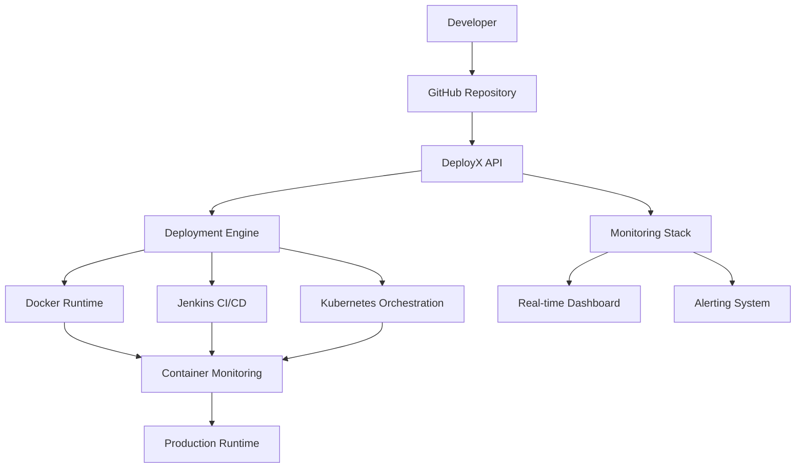

<div align="center">


# DeployX

### Modern Self-Hosted DevOps Deployment Platform


### Modern Self-Hosted DevOps Deployment Platform .


### Modern Self-Hosted DevOps Deployment Platform .


# <span style="color:#ef4444">Deploy</span><span style="color:#2563eb">X</span>


### 🚀 Modern Self-Hosted DevOps Deployment Platform

### Modern Self-Hosted DevOps Deployment Platform  .


> Deploy, orchestrate, monitor & scale production applications from your own infrastructure —
> <b>inspired by Vercel · Railway · Render · Kubernetes</b>

### Modern Self-Hosted DevOps Deployment Platform .


<br/>

[](https://opensource.org/licenses/MIT)
[](https://github.com/tanvishinde017/DeployX)
[](https://www.python.org/)
[](https://react.dev/)
[](https://www.docker.com/)
[](https://www.jenkins.io/)
[](https://kubernetes.io/)
[](https://prometheus.io/)
[](https://grafana.com/)

<br/>


<br/>

**🧱 Quickly Get Started**

[Documentation](#features) • [Quick Start](#installation-guide) • [Features](#key-features) • [Contributing](#contributing)

<br/>

<p>
  
  
  
</p>

</div>

---

## Overview

DeployX is a production-grade, self-hosted DevOps deployment platform that brings the power of modern cloud deployment infrastructure to your own environment. Inspired by industry-leading platforms like Vercel, Railway, Render, and Kubernetes, DeployX provides developers and teams with a comprehensive solution for automating application deployment, container orchestration, continuous integration, and infrastructure monitoring .

### The Problem DeployX Solves

Modern application deployment often requires complex infrastructure setup, manual configuration, and fragmented tooling across multiple services. Developers struggle with:
- **Complex deployment pipelines** requiring manual intervention
- **Fragmented monitoring** across different services
- **Lack of unified visibility** into deployment lifecycle
- **High costs** of managed cloud platforms
- **Vendor lock-in** with proprietary solutions

DeployX addresses these challenges by providing a unified, self-hosted platform that combines the best practices from leading deployment platforms while maintaining complete control over your infrastructure.

### Complete Deployment Lifecycle

DeployX orchestrates the entire deployment lifecycle from code to production:

1. **Repository Integration** – Seamless GitHub integration with webhook support
2. **Automated Build** – Framework detection and Dockerfile generation
3. **Containerization** – Docker-based runtime isolation and management
4. **CI/CD Pipeline** – Jenkins-powered continuous integration and deployment
5. **Orchestration** – Kubernetes-based container orchestration and scaling
6. **Monitoring** – Real-time infrastructure monitoring with Grafana-style dashboards
7. **Observability** – Live logs, metrics, and health checks
8. **Production Delivery** – Automatic URL generation and traffic routing

---

## Key Features

### GitHub Deployments

DeployX provides seamless GitHub integration for automated deployments:

**Overview**
- Connect any GitHub repository with a single click
- Automatic webhook configuration for push-based deployments
- Support for branches, tags, and pull request deployments
- Real-time deployment status synchronization

**Benefits**
- **Zero Configuration** – No complex CI/CD setup required
- **Instant Deployments** – Deploy on every push to your repository
- **Branch Isolation** – Deploy preview environments for every branch
- **Rollback Capability** – Instantly revert to previous deployments
- **Team Collaboration** – Share deployment URLs with your team

**Technical Implementation**
- GitHub OAuth integration for secure repository access
- Webhook-based deployment triggers
- Git-based deployment history and version tracking
- Automatic repository cloning and dependency resolution
- Deployment-specific environment configuration

---

### Docker Runtime Engine

DeployX leverages Docker for consistent, reproducible deployments:

**Overview**
- Automatic Dockerfile generation based on framework detection
- Multi-stage builds for optimized image sizes
- Container isolation for secure runtime environments
- Support for custom Dockerfiles and build configurations
- Jenkins integration for build automation

**Benefits**
- **Environment Consistency** – Same environment from development to production
- **Portability** – Deploy anywhere Docker runs
- **Resource Efficiency** – Optimized container resource utilization
- **Security** – Process isolation and resource constraints
- **Scalability** – Easy horizontal scaling with container replication

**Technical Implementation**
- Framework-specific Dockerfile templates (Node.js, Python, Go, etc.)
- Multi-stage build optimization
- Container health checks and automatic restarts
- Volume management for persistent storage
- Network isolation and service discovery

---

### Jenkins CI/CD

Integrated Jenkins pipeline for advanced CI/CD workflows:

**Overview**
- Pre-configured Jenkins integration for build automation
- Customizable pipeline stages for testing and deployment
- Build artifact management and caching
- Parallel job execution for faster builds

**Benefits**
- **Flexible Pipelines** – Custom Jenkinsfile support for complex workflows
- **Build Caching** – Faster builds with dependency caching
- **Testing Integration** – Automated test execution before deployment
- **Artifact Management** – Store and track build artifacts
- **Plugin Ecosystem** – Access to 1000+ Jenkins plugins

**Technical Implementation**
- Jenkins master-worker architecture
- Pipeline as Code with Jenkinsfile support
- Docker-based Jenkins agents for isolated builds
- Build triggers from GitHub webhooks
- Integration with DeployX deployment engine

---

### Real-Time Monitoring

Grafana-inspired monitoring dashboard for complete infrastructure visibility:

**Overview**
- Real-time CPU, memory, and network monitoring
- Container-specific resource tracking
- Historical metrics with time-series data
- Customizable dashboards and alerting

**Benefits**
- **Complete Visibility** – Monitor every aspect of your infrastructure
- **Proactive Alerting** – Get notified before issues impact users
- **Performance Optimization** – Identify bottlenecks and optimize resources
- **Capacity Planning** – Make data-driven scaling decisions
- **Debugging Support** – Correlate performance issues with deployments

**Technical Implementation**
- Prometheus-compatible metrics collection
- WebSocket-based real-time updates
- Time-series database for historical data
- Custom alert rules and notifications
- Exportable dashboard configurations

---

### Live Deployment Logs

Real-time log streaming for complete deployment visibility:

**Overview**
- Live log streaming from build and deployment processes
- Container stdout/stderr aggregation
- Log search and filtering capabilities
- Historical log retention and analysis

**Benefits**
- **Debugging** – Quickly identify and fix deployment issues
- **Transparency** – Complete visibility into deployment process
- **Audit Trail** – Track all deployment activities
- **Troubleshooting** – Access logs for incident response
- **Compliance** – Maintain logs for regulatory requirements

**Technical Implementation**
- WebSocket-based log streaming
- Structured log parsing and indexing
- Log aggregation from multiple containers
- Searchable log history
- Log export and archival

---

### Deployment Pipelines

Visual pipeline management for complex deployment workflows:

**Overview**
- Visual representation of deployment stages
- Custom pipeline configuration
- Stage-based approval workflows
- Parallel and sequential stage execution

**Benefits**
- **Clarity** – Visual understanding of deployment process
- **Control** – Manual approvals for critical stages
- **Flexibility** – Customize pipelines for your workflow
- **Efficiency** – Parallel execution for faster deployments
- **Reliability** – Stage-based validation and rollback

**Technical Implementation**
- DAG-based pipeline orchestration
- Stage dependency management
- Conditional execution based on previous stages
- Manual approval gates
- Pipeline templates and reuse

---

### Kubernetes Orchestration

Production-grade Kubernetes integration for container orchestration:

**Overview**
- Automatic Kubernetes resource generation
- Deployment and service management
- Ingress configuration for external access
- Horizontal Pod Autoscaling support

**Benefits**
- **High Availability** – Self-healing and automatic failover
- **Scalability** – Automatic scaling based on traffic
- **Load Balancing** – Built-in service discovery and load balancing
- **Rolling Updates** – Zero-downtime deployments
- **Resource Management** – Efficient resource utilization

**Technical Implementation**
- Kubernetes Deployments for application management
- Services for internal and external networking
- Ingress controllers for HTTP/HTTPS routing
- ConfigMaps and Secrets for configuration management
- Horizontal Pod Autoscaler for automatic scaling

---

### Infrastructure Monitoring

Comprehensive infrastructure health monitoring:

**Overview**
- System-wide resource monitoring
- Service health checks
- Network performance tracking
- Storage utilization monitoring

**Benefits**
- **System Health** – Monitor overall infrastructure health
- **Capacity Management** – Track resource utilization trends
- **Performance Monitoring** – Identify system bottlenecks
- **Predictive Analysis** – Anticipate resource needs
- **Cost Optimization** – Right-size infrastructure based on usage

**Technical Implementation**
- Node-level metrics collection
- Service discovery and monitoring
- Network flow monitoring
- Disk I/O and storage tracking
- Custom metric collection and aggregation

---

### Health Monitoring

Application-level health monitoring and alerting:

**Overview**
- HTTP health check endpoints
- Custom health check configurations
- Automatic service restart on failure
- Health-based traffic routing

**Benefits**
- **Reliability** – Automatic detection and recovery from failures
- **User Experience** – Route traffic only to healthy instances
- **Quick Recovery** – Automatic restart of failed services
- **Custom Checks** – Define health checks specific to your application
- **Integration** – Works with load balancers and service meshes

**Technical Implementation**
- Configurable health check endpoints
- HTTP and TCP health check protocols
- Health check intervals and timeouts
- Failure thresholds and recovery policies
- Health status propagation to monitoring systems

---

### Production URL Management

Automatic URL generation and management for deployments:

**Overview**
- Automatic subdomain generation for each deployment
- Custom domain support
- SSL/TLS certificate management
- URL routing and redirection

**Benefits**
- **Instant Access** – Get production URLs immediately after deployment
- **Custom Domains** – Use your own domains for production
- **Security** – Automatic SSL/TLS for all deployments
- **Flexibility** – Support for multiple environments and domains
- **Professional** – Clean, memorable URLs for your applications

**Technical Implementation**
- Dynamic DNS configuration
- Let's Encrypt integration for SSL
- Ingress-based routing
- Domain validation and verification
- URL redirection and rewriting

---

## Platform Architecture



**Architecture Flow:**
1. **Developer** pushes code to GitHub
2. **GitHub Repository** triggers webhook to DeployX
3. **DeployX API** processes deployment request
4. **Deployment Engine** orchestrates the deployment
5. **Docker Runtime** builds and runs containers
6. **Jenkins CI/CD** executes build and test pipelines
7. **Kubernetes Orchestration** manages container scaling
8. **Container Monitoring** collects metrics and logs
9. **Production Runtime** serves the application
10. **Monitoring Stack** provides visibility and alerting

---

## Technology Stack

| Layer | Technology | Purpose |
|-------|------------|---------|
| **Frontend** | React 18 + Vite | Modern, fast UI framework |
| **Backend** | Flask + Python 3.8+ | RESTful API and business logic |
| **Realtime Communication** | Flask-SocketIO | WebSocket-based real-time updates |
| **Containerization** | Docker | Container runtime and image management |
| **CI/CD** | Jenkins | Build automation and pipeline execution |
| **Orchestration** | Kubernetes | Container orchestration and scaling |
| **Monitoring** | Prometheus + Grafana | Metrics collection and visualization |
| **Charts** | Recharts | Interactive data visualization |
| **Animations** | Framer Motion | Smooth UI animations |
| **API Communication** | Axios | HTTP client for API requests |
| **Styling** | CSS3 | Modern styling and responsive design |
| **Database** | SQLite | Lightweight data persistence |

---

## Deployment Lifecycle

DeployX automates the complete deployment lifecycle:


**Lifecycle Stages:**

1. **Repository Submission** – User submits GitHub repository URL through the DeployX dashboard
2. **Repository Clone** – DeployX clones the repository to a temporary workspace
3. **Framework Detection** – Automatic detection of application framework and dependencies
4. **Dockerfile Generation** – Framework-specific Dockerfile is generated or custom Dockerfile is used
5. **Image Build** – Docker image is built with all dependencies and optimizations
6. **Container Creation** – Container is created from the built image with proper configuration
7. **Health Checks** – Application health is verified through configured health check endpoints
8. **URL Generation** – Production URL is generated and DNS is configured
9. **Monitoring Activation** – Monitoring agents are deployed and metrics collection begins

---

## Monitoring Features

DeployX provides comprehensive monitoring capabilities:

### CPU Monitoring
- Real-time CPU utilization tracking per container
- CPU usage percentage and core allocation
- Historical CPU trends and patterns
- CPU-based alerting and thresholds

### RAM Monitoring
- Memory usage tracking per container
- Memory allocation and utilization percentage
- Memory leak detection and alerting
- Historical memory usage patterns

### Network Monitoring
- Network RX/TX throughput tracking
- Connection monitoring and statistics
- Network latency and error rates
- Bandwidth utilization analysis

### Container Monitoring
- Per-container resource tracking
- Container lifecycle monitoring
- Container health status
- Container restart tracking

### Historical Metrics
- Time-series data storage
- Historical trend analysis
- Metric retention policies
- Exportable metric data

### Realtime Charts
- Live metric visualization
- Interactive chart exploration
- Customizable time ranges
- Multiple metric comparison

### WebSocket Updates
- Real-time metric streaming
- Low-latency updates
- Efficient data transfer
- Automatic reconnection

---

## CI/CD Workflow

DeployX integrates with Jenkins to provide powerful CI/CD capabilities:

### Pipeline Stages

1. **Checkout** – Clone repository from GitHub
2. **Install Dependencies** – Install project dependencies based on detected framework
3. **Lint** – Run code linting and style checks
4. **Test** – Execute unit and integration tests
5. **Build** – Build application artifacts
6. **Dockerize** – Build Docker image with application
7. **Push** – Push image to container registry
8. **Deploy** – Deploy to Kubernetes cluster
9. **Verify** – Run post-deployment verification tests
10. **Notify** – Send deployment status notifications

### Jenkins Integration Features

- **Jenkinsfile Support** – Use custom Jenkinsfiles for complex pipelines
- **Parallel Execution** – Run stages in parallel for faster builds
- **Build Caching** – Cache dependencies for faster builds
- **Artifact Storage** – Store and retrieve build artifacts
- **Plugin Ecosystem** – Access to Jenkins plugin marketplace
- **Build Triggers** – Trigger builds from GitHub webhooks
- **Build History** – Track all build history and artifacts

---

## Kubernetes Support

DeployX provides comprehensive Kubernetes integration:

### Pods
- Automatic pod creation and management
- Pod health monitoring and self-healing
- Resource requests and limits
- Pod scheduling and placement

### Deployments
- Declarative deployment configuration
- Rolling updates and rollbacks
- Replica management
- Deployment history and revision tracking

### Services
- Service discovery and load balancing
- ClusterIP, NodePort, and LoadBalancer services
- Service mesh integration support
- Endpoint management

### Ingress
- HTTP/HTTPS routing configuration
- TLS/SSL certificate management
- Path-based routing
- Custom domain support

### Replica Scaling
- Horizontal Pod Autoscaler integration
- Custom scaling policies
- Metrics-based scaling
- Scheduled scaling

### Self Healing
- Automatic pod restart on failure
- Health check-based recovery
- Node failure handling
- Automatic rescheduling

---

## Folder Structure

```txt
DeployX/
│
├── backend/
│   ├── app.py                      # Main Flask application
│   ├── database.py                 # Database configuration and models
│   ├── requirements.txt            # Python dependencies
│   ├── test_jenkins.py             # Jenkins integration tests
│   ├── deployments/                # Deployment-related files
│   ├── logs/                       # Application logs
│   ├── managers/                   # Manager classes
│   ├── scripts/                    # Utility scripts
│   │   └── list_jenkinsfiles.py   # Jenkins file listing utility
│   ├── services/                   # Business logic services
│   │   └── framework_detector.py  # Framework detection logic
│   └── sockets/                    # WebSocket handlers
│
├── frontend/
│   ├── index.html                  # Entry HTML file
│   ├── package.json                # Node dependencies
│   ├── vite.config.js             # Vite configuration
│   ├── public/                     # Static assets
│   ├── src/
│   │   ├── components/             # Reusable UI components
│   │   │   ├── Dashboard.jsx
│   │   │   ├── Navbar.jsx
│   │   │   └── ...
│   │   ├── pages/                  # Page components
│   │   │   ├── Dashboard.jsx
│   │   │   ├── Settings.jsx
│   │   │   ├── Analytics.jsx
│   │   │   └── LandingPage/
│   │   │       ├── LandingPage.jsx
│   │   │       └── LandingPage.css
│   │   ├── services/               # API service layer
│   │   ├── hooks/                  # Custom React hooks
│   │   ├── styles/                 # Global styles
│   │   │   ├── styles.css
│   │   │   └── global.css
│   │   ├── App.jsx                 # Main App component
│   │   └── main.jsx                # Application entry point
│   │
├── jenkins/
│   ├── Dockerfile                  # Jenkins Docker configuration
│   └── Jenkinsfile                 # Pipeline definition
│
├── docker-compose.yml              # Docker Compose configuration
├── .gitignore                      # Git ignore rules
├── .env                           # Environment variables (not committed)
└── README.md                      # This file
```

---

## Installation Guide

### Prerequisites

- Python 3.8 or higher
- Node.js 16 or higher
- Docker 20.10 or higher
- Kubernetes 1.20 or higher (optional)
- Jenkins 2.300 or higher (optional)
- Git

### Backend Setup

1. **Clone the repository**
   ```bash
   git clone https://github.com/tanvishinde017/DeployX.git
   cd DeployX
   ```

2. **Navigate to backend directory**
   ```bash
   cd backend
   ```

3. **Create virtual environment**
   ```bash
   python -m venv venv
   source venv/bin/activate  # On Windows: venv\Scripts\activate
   ```

4. **Install dependencies**
   ```bash
   pip install -r requirements.txt
   ```

5. **Configure environment variables**
   ```bash
   cp .env.example .env
   # Edit .env with your configuration
   ```

6. **Initialize database**
   ```bash
   python database.py
   ```

7. **Start the backend server**
   ```bash
   python app.py
   ```

The backend API will be available at `http://127.0.0.1:5000`

### Frontend Setup

1. **Navigate to frontend directory**
   ```bash
   cd frontend
   ```

2. **Install dependencies**
   ```bash
   npm install
   ```

3. **Configure environment variables**
   ```bash
   cp .env.example .env
   # Edit .env with your configuration
   ```

4. **Start the development server**
   ```bash
   npm run dev
   ```

The frontend will be available at `http://localhost:5173`

### Docker Setup

1. **Build Docker images**
   ```bash
   docker-compose build
   ```

2. **Start all services**
   ```bash
   docker-compose up -d
   ```

3. **View logs**
   ```bash
   docker-compose logs -f
   ```

### Jenkins Setup

1. **Install Jenkins**
   ```bash
   # Using Docker
   docker run -d -p 8080:8080 -p 50000:50000 jenkins/jenkins:lts
   ```

2. **Install required plugins**
   - Docker Plugin
   - GitHub Plugin
   - Pipeline Plugin
   - Kubernetes Plugin

3. **Configure Jenkins**
   - Add Docker credentials
   - Configure GitHub webhook
   - Set up pipeline jobs

### Kubernetes Setup

1. **Create Kubernetes cluster**
   ```bash
   # Using minikube for local development
   minikube start
   ```

2. **Apply DeployX configurations**
   ```bash
   kubectl apply -f kubernetes/deployments/
   kubectl apply -f kubernetes/services/
   kubectl apply -f kubernetes/ingress/
   ```

3. **Verify deployment**
   ```bash
   kubectl get pods
   kubectl get services
   ```

---

## Configuration

### Environment Variables

Create a `.env` file in the backend directory with the following variables:

**Backend (.env)**
```env
# Server Configuration
FLASK_ENV=development
FLASK_DEBUG=True
SECRET_KEY=your-secret-key-here

# Database
DATABASE_URL=sqlite:///deployx.db

# GitHub Integration
GITHUB_CLIENT_ID=your-github-client-id
GITHUB_CLIENT_SECRET=your-github-client-secret
GITHUB_WEBHOOK_SECRET=your-webhook-secret

# Docker Configuration
DOCKER_HOST=unix://var/run/docker.sock
DOCKER_REGISTRY=your-registry-url

# Jenkins Configuration
JENKINS_URL=http://localhost:8080
JENKINS_USERNAME=your-jenkins-username
JENKINS_API_TOKEN=your-jenkins-token

# Kubernetes Configuration
KUBERNETES_CONFIG_PATH=~/.kube/config
KUBERNETES_NAMESPACE=deployx

# Monitoring
PROMETHEUS_URL=http://localhost:9090
GRAFANA_URL=http://localhost:3000

# Ports
BACKEND_PORT=5000
FRONTEND_PORT=5173
```

### Ports

| Service | Default Port | Description |
|---------|-------------|-------------|
| Backend API | 5000 | Flask REST API |
| Frontend | 5173 | React development server |
| Jenkins | 8080 | Jenkins web interface |
| Prometheus | 9090 | Metrics collection |
| Grafana | 3000 | Monitoring dashboard |
| Kubernetes API | 6443 | Kubernetes cluster API |

### Runtime Settings

**Docker Settings**
- Container memory limit: 512MB (configurable)
- Container CPU limit: 0.5 cores (configurable)
- Network mode: bridge
- Restart policy: unless-stopped

**Kubernetes Settings**
- Default replicas: 2
- Resource requests: 256MB RAM, 0.25 CPU
- Resource limits: 512MB RAM, 0.5 CPU
- Autoscaling: 2-10 replicas based on CPU

---

## Future Roadmap

### Phase 1: Core Enhancements (Q1 2026)

- **Authentication & Authorization**
  - OAuth integration (GitHub, Google, GitLab)
  - Role-based access control (RBAC)
  - Team management and collaboration
  - SSO support for enterprise

- **Custom Domains**
  - Custom domain configuration
  - Automatic SSL/TLS certificate management
  - Domain verification and validation
  - Wildcard certificate support

- **Deployment Rollbacks**
  - One-click rollback to previous versions
  - Automatic rollback on health check failure
  - Rollback history and analytics
  - Blue-green deployments

### Phase 2: Advanced Features (Q2 2026)

- **Cloud Provider Integration**
  - AWS ECS integration
  - Google Cloud Run support
  - Azure Container Instances
  - Multi-cloud deployment support

- **Multi-User Support**
  - User accounts and profiles
  - Team workspaces
  - Resource quotas per user
  - Billing and usage tracking

- **Autoscaling**
  - CPU-based autoscaling
  - Memory-based autoscaling
  - Request-based autoscaling
  - Scheduled scaling policies

### Phase 3: Intelligence & Analytics (Q3 2026)

- **AI Assistant**
  - Natural language deployment commands
  - Intelligent error diagnosis
  - Performance optimization suggestions
  - Automated issue resolution

- **Advanced Analytics**
  - Deployment success rate analytics
  - Performance trend analysis
  - Cost optimization recommendations
  - Custom analytics dashboards

- **Advanced Monitoring**
  - Distributed tracing integration
  - APM (Application Performance Monitoring)
  - Custom metrics and alerts
  - Log analysis and anomaly detection

---

## Contributing

We welcome contributions from the community! DeployX is an open-source project, and we value all contributions.

### How to Contribute

1. **Fork the repository**
   ```bash
   https://github.com/tanvishinde017/DeployX/fork
   ```

2. **Create a feature branch**
   ```bash
   git checkout -b feature/your-feature-name
   ```

3. **Make your changes**
   - Follow the existing code style
   - Add tests for new features
   - Update documentation as needed

4. **Commit your changes**
   ```bash
   git commit -m "feat: add your feature description"
   ```

5. **Push to your branch**
   ```bash
   git push origin feature/your-feature-name
   ```

6. **Create a Pull Request**
   - Describe your changes in detail
   - Link related issues
   - Ensure all CI checks pass

### Development Guidelines

- **Code Style**
  - Python: Follow PEP 8 guidelines
  - JavaScript: Use ESLint configuration
  - React: Follow React best practices

- **Testing**
  - Write unit tests for new features
  - Ensure all tests pass before submitting
  - Maintain test coverage above 80%

- **Documentation**
  - Update README for user-facing changes
  - Add inline comments for complex logic
  - Update API documentation for API changes

### Areas for Contribution

- **UI/UX Improvements**
  - Dashboard enhancements
  - Better mobile responsiveness
  - Accessibility improvements
  - New component designs

- **Feature Additions**
  - New deployment providers
  - Additional monitoring metrics
  - Enhanced CI/CD integrations
  - New framework support

- **Performance**
  - Backend optimization
  - Frontend performance improvements
  - Database query optimization
  - Caching strategies

- **Documentation**
  - API documentation
  - Architecture diagrams
  - Deployment guides
  - Tutorial content

---

## License

This project is licensed under the MIT License - see the [LICENSE](LICENSE) file for details.

---

## Authors

### Tanavi Shinde
- GitHub: [@tanvishinde017](https://github.com/tanvishinde017)
- Role: Frontend Developer, UI/UX Design

### Sahil Reshim
- GitHub: [@sahilreshim](https://github.com/sahilreshim)
- Role: Core Developer, Architecture Design

---

## Acknowledgements

DeployX is inspired by and built upon the excellent work of these projects and platforms:

- **Vercel** - For pioneering modern deployment workflows and developer experience
- **Railway** - For elegant application deployment and infrastructure abstraction
- **Render** - For comprehensive platform-as-a-service features
- **Docker** - For revolutionizing containerization and application packaging
- **Jenkins** - For providing robust CI/CD automation capabilities
- **Kubernetes** - For industry-standard container orchestration
- **Grafana** - For powerful monitoring and visualization
- **Prometheus** - For metrics collection and alerting
- **React** - For the amazing frontend framework
- **Flask** - For the lightweight and powerful Python web framework

Special thanks to the open-source community for creating and maintaining these incredible tools that make DeployX possible.

---

<div align="center">

## ⭐ Star Us on GitHub!

If you find DeployX useful, please consider giving us a star on GitHub. It helps us grow and motivates us to keep improving the project.

[](https://github.com/tanvishinde017/DeployX)

**Built with ❤️ by the DeployX Team**

</div>
